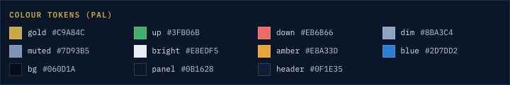
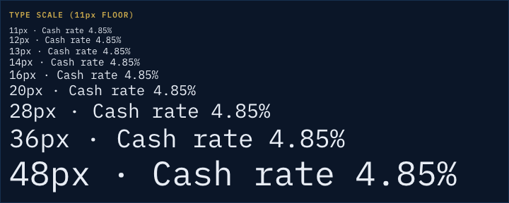
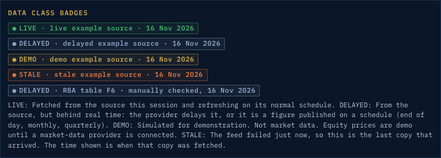
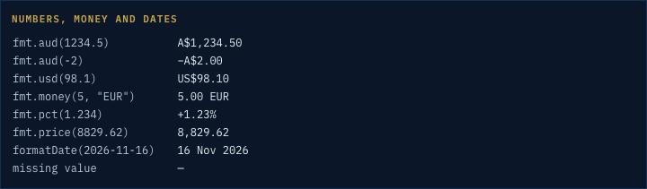
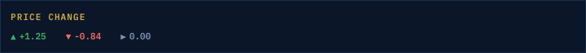
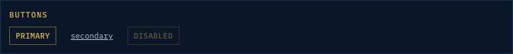
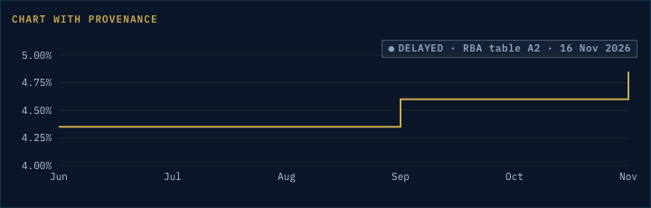

# Maddex design system

Workstream 3, 19 Nov 2026. The parts every module uses, and the rules for
using them.

Each image below is a baseline that the visual regression suite compares
against: `npm run test:visual`, which also runs in the gate as part of
`npm run test:ui`. The live page is `/?components`, which shows every part
with fixed data.

To record new baselines after an intended design change, run
`UPDATE_BASELINES=1 npm run test:visual`.

## Colour tokens

`src/styles/palette.js` (`PAL`). Tailwind's `terminal-*` classes resolve to
the same values. Every text colour passes WCAG AA (4.5:1) on every panel
background (tests/designSystem.test.mjs).

- `up` and `down` are for price changes only. Facts that are not prices
  (decisions, ratings, statuses) use neutral colours.
- Status colours always come with a word or an icon, never colour alone.

## Type

One scale: 11, 12, 13, 14, 16, 20, 28, 36 and 48px. Nothing is smaller than
11px. A test fails on any other size; the three held RBA cards are exempt
until their hold ends.

## Data classes

Every figure is one of four classes, shown with its source and time by
`DataBadge`:

- **LIVE**
- **DELAYED**
- **DEMO** (simulated)
- **STALE** (the last copy, after a feed failed)

A figure a person read from the issuer has a badge ending "manually checked,
DATE" (the `manual` prop). Every module header's DATA button lists the
module's datasets (docs/DATA_PLATFORM.md).

## Numbers, money and dates

`src/utils/format.js` (`fmt`) and `src/utils/dateUtils.js` (`formatDate`,
`sydneyClock`).

- **Money:** always A$ or US$ (`fmt.aud`, `fmt.usd`, `fmt.money(n,
  currency)`), never a bare "$". Other currencies follow the amount as an ISO
  code. Negatives use a true minus (−).
- **Percent:**
  - `fmt.pct`: two decimals for a day's price change, with a sign.
  - Rates: two decimals.
  - Statistics: as the agency publishes them, usually one decimal.
- **Dates:** "16 Nov 2026" (`formatDate`). Times are Sydney time, with the
  zone named (AEDT or AEST). A raw ISO date is never shown to a reader.
- **Missing:** a missing value is "—", never 0.

Tests fail on a bare "$" amount or a raw "as at" date (tests/formatting.test.mjs).

## Buttons

Primary actions are gold-outlined. Secondary actions are dim text.

Buttons on phones get 44px targets (Workstream 7).

## Charts

One style: `src/styles/chartTheme.js` (`CHART`).

- 11px muted ticks, no axis lines.
- A faint horizontal grid.
- 2px lines with no dots.
- A tooltip on the panel colour.
- No dual axes. Series colours follow the entity, not its rank.

Every chart goes through `SafeChart`, which requires a `provenance`:

| Provenance | Shown | Use when |
|---|---|---|
| `{ cls, source, at, manual }` | A data badge in the chart's corner | The chart's own data |
| `"panel"` | Nothing extra | The enclosing panel header already shows class, source and date for this data |
| `"sparkline"` | Nothing extra | A small inline trend beside a figure that is badged |
| `"calculated"` | "Calculated from your inputs" | Projections from the reader's own inputs or holdings |

Equity charts use `equityProvenance()` (`src/utils/chartProvenance.js`). It
gives DEMO while prices are simulated, and DELAYED with the provider once a
licensed feed is connected. A test fails on any chart without a provenance
(tests/chartProvenance.test.mjs).

